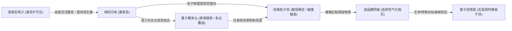
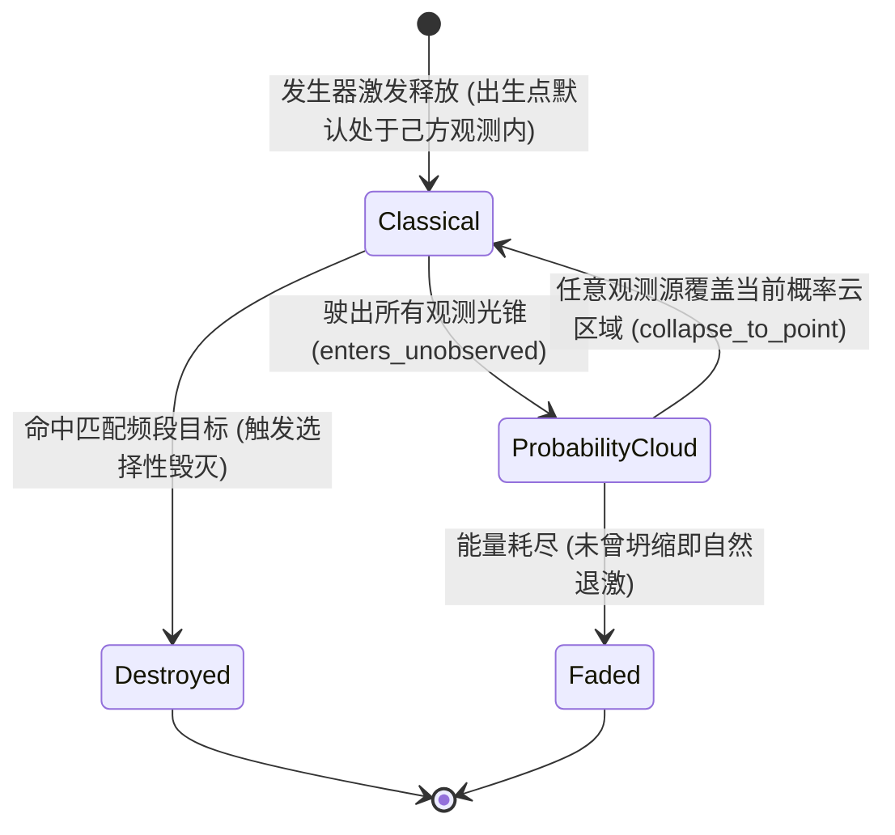

# 《代号：宏电子》（Project: Macro-Electron）游戏产品需求文档（PRD）

> **原著世界观基石**：刘慈欣《球状闪电》（宏电子理论、选择性毁灭、观察者效应与量子态、宏聚变）  
> **文档版本**：v1.0  
> **创建日期**：2026-11-21  
> **产品形态**：2.5D 俯视角硬核科幻战术解谜游戏（支持实时行动 + 战术时停推演）  
> **目标平台**：Web / PC（优先基于 WebGL / Canvas2D 打造可交互 Demo）

---

## 1. 产品愿景与第一性原理

### 1.1 问题本质（为什么这样设计？）
绝大多数“量子/硬科幻”题材游戏往往将量子概念降格为“换皮魔法”（如把瞬移叫量子跳跃、把普通能量球叫闪电）。《球状闪电》真正令人震撼的灵魂，在于**用极度冷酷、精确的物理规则重构毁灭与存在本身**。

用第一性原理拆解原著，其玩法潜力可凝练为三条不可妥协的**物理公理**：
1. **选择性毁灭（Selective Resonance）**：球状闪电并非无差别轰炸，而是宏电子处于激发态时对**特定谐振频段物质**的精准抹除。这天然构成了极高策略密度的“保 A 灭 B”战术拆解空间。
2. **观察者效应（Observer Effect）**：没有观察者时，宏电子退化为弥散穿墙的**量子概率云**；一旦进入任何物理观测源的覆盖范围，波函数立即坍缩为确定的经典实体。**“主动放弃观测”本身成为一种核心战术武器。**
3. **非线性的场态导引（Nonlinear Field Guidance）**：球状闪电不是直线子弹，它在复杂地形中受导体吸引、磁偏转、空气电离路径牵引，具有高美感与高推演上限的轨道动力学。

### 1.2 核心定位与体验目标
| 维度 | 定义 |
| :--- | :--- |
| **一句话概念** | 操控与频率共鸣的“球状闪电”，利用电磁场导引轨迹，并在“观测与盲区”之间切换其量子概率云形态，对敌方目标实施外科手术式的选择性抹除。 |
| **核心体验循环** | **勘察材质与视锥 → 调谐频段与布设磁场 → 盲区穿墙扩散 → 主动观测引爆坍缩** |
| **设计参考系** | 《Into the Breach》（棋盘式因果推演）× 《Frozen Synapse》（视锥与时停战术）× 《Portal》（单一底层规则衍生的无限解谜空间） |
| **关键设计隔离** | **玩家视角 ≠ 物理观测者**。玩家在控制台看到的地形线框蓝图不触发波函数坍缩；唯有部署在战场中的物理传感器（肉眼、探照灯、雷达、主动观测信标）才构成“观测”。 |

---

## 2. 世界观设定与游戏化转译



### 2.1 三大系统级转译表
| 原著概念 | 物理表现 | 游戏核心机制 |
| :--- | :--- | :--- |
| **宏电子激发态** | 空气中飘荡的诡异光球，寿命有限，遇导体偏转 | 具有能量衰减槽、受电磁矢量场牵引的动态发射体 |
| **特定物质销毁** | 烧毁电脑芯片却不伤纸张；气化人体却保留衣物 | **四元物质频谱系统（α / β / γ / δ）**，复合单位按频段剥离组件 |
| **观察者与波函数坍缩** | 无人观察时物质呈概率云分布，观察瞬间坍缩 | **全图视锥演算**：暗区扩散穿透墙体，亮区锁定并引爆坍缩 |
| **宏聚变 / 量子幽灵** | 宏核聚变大范围清零；死去的人以概率态存在 | 终局全局清零机制；暗区可互动的隐藏“幽灵助益节点” |

---

## 3. 核心玩法循环与操作模型

### 3.1 单局体验节奏（4 步闭环）
1. **推演勘察（Recon & Analysis）**
   - 玩家进入关卡（默认或按 `Space` 进入**战术时停 / 推演模式**）。
   - 查看敌方设施与单位的**复合材质标签**（例如：`炮塔 = δ金属外壳 + α火控芯片 + β导弹弹药`）。
   - 观察场景中所有**物理观测区**（绿色/白色扫描光锥）与**完全无观测盲区**（深邃量子暗区）。
2. **调谐与布阵（Tune & Deploy）**
   - 选定本次发射宏电子的**谐振频段（α / β / γ / δ）**。
   - 在可部署点放置有限的战术装置：**超导磁偏转器**（改变飞行曲率）、**高压引雷针**（强力吸附并续能）、**光学遮蔽幕/EMP**（暂时制造观测盲区）或**主动观测信标**（可远程开关的坍缩引爆器）。
3. **激发与量子渗透（Launch & Tunneling）**
   - 发射球状闪电，取消时停进入实时（或高速步进）演算。
   - 球状闪电在电磁导引下绕过障碍，刻意驶入没有探头和士兵视线的**盲区**，瞬间蜕变为弥散的**概率云**，无视实体墙体和防弹护盾向密室/防线内部扩散覆盖。
4. **精准坍缩与连锁效应（Collapse & Chain）**
   - 当概率云的波峰刚好覆盖目标区域时，玩家一键**开启主动观测信标（或等待敌方探照灯扫过）**。
   - 波函数瞬间坍缩：球状闪电直接在密室内部显形并释放，仅抹除选定频段的物质（例如精准气化敌方弹药库引发次生殉爆，或瘫痪所有电子门禁而保全人质）。

### 3.2 操控与推演控制
| 输入操作 | 功能说明 |
| :--- | :--- |
| **鼠标左键 / 拖拽** | 部署/旋转电磁导引器、选择发球角度、开关主动观测信标 |
| **数字键 `1` `2` `3` `4`** | 切换宏电子谐振频段（`α 硅基` / `β 含能` / `γ 有机` / `δ 金属`） |
| **`Space`（空格键）** | 切换 **实时演算 ↔ 战术时停推演**（可无限次暂停调整观测灯状态与查看预测力线） |
| **`Tab` 键** | 切换 **蓝图材质视图**（高亮所有物体的四元材质构成与电磁力线分布） |
| **`R` 键** | 快速重置当前实验回合（零惩罚复盘，鼓励试错） |

---

## 4. 核心机制详述（可量化规则与边界条件）

### 4.1 机制一：宏电子动力学与电磁导引
球状闪电作为物理实体，拥有以下核心属性：
- **能量寿命（Stability）**：初始 `100` 点，每秒自然衰减 `10` 点（经典态）或 `6` 点（概率云态）。当寿命降为 `0` 时，宏电子退激为不可见基态并消散。
- **速度与运动方程**：
  - 拥有基础恒定巡航速率 $v_0$（例如 `160 px/s`）。
  - 每一物理帧（固定步长 `dt = 1/60 s`），速度方向受到周围电磁装置的矢量合力偏移：
    - **高压引雷针（Attractor）**：在半径 $R_a$ 内产生向心引力，使球状闪电向其弯曲；若经过其核心区域（`r < 18 px`），可为球状闪电补充 `+30` 能量寿命并产生一次“过载折跃”。
    - **超导磁偏转器（Deflector）**：具有可调节的朝向角 $\theta$，当球状闪电进入作用圈，施加切向偏转力矩，将其平滑引导至指定出射方向。
    - **普通导电金属墙/铁丝网**：对经典态球状闪电产生微弱吸附贴壁效应（沿金属边缘滑行）。
- **防死锁规则（Anti-Loop Guard）**：为了防止球状闪电围绕某根避雷针做无限圆周运动，引雷针的续能效果有 **每颗雷球最多触发 1 次** 的冷却限制，能量耗尽即自然消散。

### 4.2 机制二：四元物质频谱与选择性毁灭
这是区分平庸射击与原著硬核战术的根本。世界中的一切可交互对象（建筑、敌人、陷阱、人质、设备）均由 **4 个材质层（Material Layers）** 组合而成：

| 频段代号 | 视觉色彩与纹理特征 | 毁灭目标物 | 战术定位与特殊交互 |
| :--- | :--- | :--- | :--- |
| **`α` 硅基/电子频段** | 幽青色 `#00E5FF`<br>脉冲电路波纹 | 计算机主机、雷达、监控探头、无人机、电子门锁、导弹制导芯片 | **“盲化与瘫痪”**：销毁敌方监控探头制造人工盲区；使自动化炮塔哑火但保留炮台掩体。 |
| **`β` 含能/高燃频段** | 炽橙色 `#FF5722`<br>内聚火核粒子 | 弹药箱、油桶、武器弹匣、导弹战斗部、反应堆燃料棒 | **“外科引爆”**：隔墙只引爆敌兵身上弹匣或战车弹药，触发连锁物理爆炸而不直接摧毁建筑承重。 |
| **`δ` 金属/结构频段** | 琥珀金 `#FFD600`<br>高频晶格震颤 | 钢制防盗门、承重钢梁、装甲板、高压电网、避雷针 | **“破甲与坍塌”**：气化金属门锁开路；融毁敌方坦克外装甲；摧毁楼宇承重柱引发物理压顶。 |
| **`γ` 有机/碳基频段** | 幽紫色 `#D500F9`<br>冷冽光晕（无声） | 生物体（敌方精锐、警卫、实验生物）、木质屏障、生物传感器 | **“绝对禁区与终极手段”**：气化特定生物目标但完整留下其携带的武器与密码卡；**高风险约束**（不可误伤人质/科研人员）。 |

#### 复合目标拆解示例（核心爽点）
- **场景**：一间密室内有 1 名人质（`γ`）、2 名持枪武装分子（`γ + β弹匣 + δ防弹衣`）和 1 台连着自毁炸弹的机密服务器（`α主板 + β炸弹`）。
- **错误解法**：用 `β` 频段直接轰炸 → 引爆炸弹毁掉服务器并杀死人质（任务失败）。
- **经典解法**：
  1. 先发射 `α` 频段球状闪电穿墙坍缩，瞬间抹除服务器的自毁引信芯片与房间内的电子摄像头（全室陷入监控盲区，同时机密数据存储介质被物理切断而保留或按关卡设定提取）。
  2. 再发射 `β` 频段只引爆武装分子枪支里的少量步枪弹药使其丧失战斗力并震晕，全程零伤及人质。

### 4.3 机制三：观察者效应与概率云坍缩规则



#### 关键演算细则（消除随机挫败感，保障确定性策略）
1. **观测覆盖计算（Observation Field）**
   - 场景中所有激活的“物理观测源”（敌方士兵面向 90° 视锥、旋转监控摄像头、雷达扫描圆、己方无人机、玩家放置的“主动观测灯”）实时投射 2D 多边形可见域（受不透明实体墙遮挡，但**可穿透玻璃窗**！）。
   - **重要交互**：玻璃窗挡得住经典态球状闪电和物理子弹，但**挡不住视线（观测）**；而混凝土实墙挡得住视线，却**挡不住概率云（量子隧穿）**！这两者的互补反差创造了极具深度的关卡谜题。
2. **概率云扩散模型（Probability Cloud Diffusion）**
   - 当球状闪电进入完全无观测的盲区时，其单一坐标点转化为一个二维**概率密度分布场 $\Psi(x, y)$**（底层实现可用 2D 网格 BFS 波前扩散）。
   - 概率云以较快速度向周围所有**相连的无观测盲区**漫延，能够轻易绕过死角、钻过门缝，甚至**在能量允许范围内渗透过一定厚度的实体墙壁**（每穿过 1 格墙体消耗额外 `15` 点能量寿命）。
   - **不可直接碰撞**：处于概率云状态时，宏电子**不会**与任何物质发生毁灭反应——它像幽灵一样同时覆盖房间内的所有物体。
3. **波函数坍缩判决（Collapse Resolution — 确定性优先原则）**
   - 一旦任意观测源照亮了概率云 $\Psi > 0$ 的区域（即“被观测区域 $\Omega_{\text{obs}}$ 与概率云 $\Psi$ 产生交集”）：
   - **坍缩点选取规则**：不在全局纯随机抽取（避免玩家频繁凹概率），而是遵循**“观测交集内的最大概率密度/优先谐振点”**确定性坍缩：
     1. 若观测交集 $\Omega_{\text{obs}} \cap \Psi$ 内存在与当前球状闪电**同频段的物质目标**，则波函数立即坍缩至**概率密度最高的那一个同频目标核心**上，并当场引爆释放！
     2. 若观测交集内没有同频目标，则坍缩至交集区域内**概率幅最大（最靠近波前中心）的自由空间点**，恢复为经典粒子态继续飞行。
   - **战术意义**：这让玩家能精准利用“手电筒/探照灯开关”实现**“隔墙定点精确闪现引爆”**——只要盲区里的概率云扩散进了装甲车内部，你用雷达或开关灯往装甲车位置晃一下，球状闪电就会无视外面 30 厘米厚的复合装甲，直接在车厢内部的火控芯片上坍缩显现！

### 4.4 特殊机制：宏聚变与量子幽灵（中后期演进）
1. **双球共鸣 / 宏聚变（Macro-Fusion）**：当两颗不同频段或特定高能态的球状闪电在极近距离被同时观测坍缩时，会触发局部**宏聚变**——瞬间形成一道扩展全场的无视遮挡脉冲，清除半径内的特定频段所有目标（在终局关卡用于大范围反制高密度敌方集群，但伴随着不可控的连锁风险）。
2. **量子幽灵（Quantum Ghost）**：部分剧情关或高难度隐藏分支中，场景存在“仅在全局 0 观测（完全黑暗）时才会浮现的幽灵实体”（表现为一团淡淡的蓝玫瑰光影或虚线人影）。当玩家主动熄灭自己和敌方的所有观测源时，量子幽灵会协助触发特定机关或改变局部磁力线，致敬原著中最具浪漫主义与悲剧色彩的结局。

---

## 5. 关卡规划与 MVP（Demo）垂直切片设计

### 5.1 战役四幕结构（规划共 12 关）
| 章节 | 名称 | 核心教学/玩法焦点 | 关卡数 |
| :--- | :--- | :--- | :---: |
| **第一幕** | **泰山与空泡实验室** | 雷球激发、避雷针引力、磁偏转器角度、能量续命 | 3 关 |
| **第二幕** | **619 武器化靶场** | α / β / δ / γ 四元频谱切换、复合单位拆解、禁毁约束 | 3 关 |
| **第三幕** | **暗室观测者** | 观察者视锥与玻璃/实墙特性、关灯潜行、隔墙概率云坍缩 | 4 关 |
| **第四幕** | **珠峰微核与芯片危机** | 宏聚变大范围清除、敌我观测博弈、量子幽灵叙事终局 | 2 关 |

### 5.2 Demo 首期必做 3 关（Vertical Slice 详细设计）
为了确保 `GameDemo` 能快速跑通并直观震撼体验者，首期仅制作 3 个高浓度关卡，每关聚焦一个不可替代的“顿悟瞬间（Aha Moment）”：

#### Demo 关卡 01：《空泡与偏转》（基础动力学 + 精准保活）
- **地形**：S 型金属回廊靶场，中央有不可穿透的厚隔板。
- **目标**：使用 1 颗 `α 频段` 球状闪电，绕过弯道摧毁终点的目标服务器（`α`）。
- **难点**：直接发射撞墙即消散，且距离超过基础 `100` 能量寿命。
- **标准解法**：在弯道处放置 1 个**超导磁偏转器**将轨道掰弯 90°，中段经过 1 根预设的**高压引雷针**吸附并补充 `+30` 能量，最终直击终点服务器。

#### Demo 关卡 02：《外科手术》（选择性频谱共振）
- **地形**：开放式试验区，正前方是一排高爆燃料桶（`β`），燃料桶紧挨着我方需要保护的珍贵黑匣子（`α`），后方是一个被钢制重门（`δ`）锁住的敌方导弹车（`α火控 + β战斗部 + δ车体`）。
- **难点**：只有 2 发发射机会。如果用 `β` 频段经过燃料桶，会引发大爆炸毁掉黑匣子（失败）。
- **标准解法**：
  1. 第 1 发切换为 **`δ` 金属频段**：球状闪电从燃料桶（`β`）旁穿过时完全无害，直接融毁正前方的钢制重门（`δ`），打通路径（甚至直接剥离导弹车装甲）。
  2. 第 2 发切换为 **`α` 硅基频段**（或 `β` 绕开油桶）：穿过已开启的通道精准摧毁导弹车的 `α` 火控芯片，令其彻底瘫痪，黑匣子毫发无损。

#### Demo 关卡 03：《看不见的房间》（观察者效应与量子穿墙）—— *核心高光关卡*
- **地形**：一个四周完全封闭的混凝土密室（无门），密室墙壁有一块**单向防弹玻璃窗**，密室内有一个敌方核心基站（`α`）；密室门口有一个来回巡逻扫描的**敌方探照灯**。玩家手头拥有 1 个可远程遥控开关的**“主动观测信标（就架在玻璃窗外侧）”**。
- **难点**：混凝土和防弹玻璃都挡住了经典态球状闪电，物理上根本进不去！
- **惊艳解法（顿悟瞬间）**：
  1. 玩家通过操作先**关闭**己方所有照明和窗户旁的“主动观测信标”，趁敌方巡逻探照灯转过去的 2 秒间隙，在密室外的盲区发射 `α` 频段球状闪电。
  2. 球状闪电一离开发射器即处于**全黑盲区**，迅速变为幽灵般的**概率云**，穿过密实墙壁漫延进密室内部！
  3. 当观察到 UI 上的干涉波纹已经渗透并覆盖密室内的核心基站时，立刻**点击开启玻璃窗外的“主动观测信标”**！
  4. 视线穿透玻璃窗瞬间覆盖密室——波函数在基站位置发生剧烈坍缩，球状闪电凭空闪现在密室内部并将基站瞬间气化！

---

## 6. 视觉、UI 与听觉美学规范

### 6.1 视觉风格基调
- **冷峻实验蓝图风（Cold Lab Blueprint）**：参考 1990 年代末军工示波器、核物理控制室监控台与现代极简几何美学。
- **色彩规范**：
  - 全局主底色（未观测暗区）：`#07090E`（深邃玄夜黑，带极微弱蓝图坐标点阵）
  - 己方/敌方观测亮区：`rgba(210, 235, 255, 0.08)` 叠加动态扫掠边缘线与轻微胶片噪点，视觉上一眼区分“观测区 vs 暗区”。
  - 球状闪电表现：
    - 经典态：高亮度双层径向发光球核 + 随频段颜色变化的高频动态抖动电弧。
    - 概率云态：使用波函数干涉环形波纹 + 弥散颗粒闪烁特效（Shader / 粒子叠加），明确传递“既在这里又在那里”的飘忽诡异感。
- **信息分层**：按 `Tab` 或在时停状态下，实体轮廓自动叠加微小的图标徽章（`[α]` `[β]` `[γ]` `[δ]`），避免玩家靠猜分辨材质。

### 6.2 HUD 界面布局（极简零冗余）
- **左上角**：当前关卡代号、实验目标清单（如：`[✓] 瘫痪目标主机` / `[!] 禁止摧毁人员`）与可用发射次数。
- **底部中央（核心操作坞）**：
  - 频谱调谐旋钮/切换条：`α 硅基` | `β 含能` | `δ 金属` | `γ 有机`（仅在对应解锁关卡显示）。
  - 战术装置栏：磁偏转器、引雷针、观测信标（显示剩余可部署数）。
  - 中央显眼的 **[ 激发 / 时停推演 ]** 与 **[ 全局关闭/开启己方观测 ]** 切换按钮。
- **右上角**：时停状态指示器（`PAUSED - TACTICAL SIMULATION`）与一键重置按钮。

### 6.3 听觉设计（还原原著质感）
- **原著标志性细节**：球状闪电毁灭目标时往往**“悄无声息”**。因此坍缩摧毁瞬间不使用俗套的轰隆爆炸声，而是使用**极短促的高频抽真空内爆声 + 晶格脆响**，随后归于短暂的绝对寂静，带来毛骨悚然的科技压迫感。
- **状态音景**：经典态伴随稳定的 50Hz 交流电低鸣；进入概率云时切换为空灵且左右声道漂移的白噪波纹声；开启主动观测灯时发出干脆的继电器咔哒声（Relay Click）。

---

## 7. 技术架构与工程落地方案（面向 GameDemo）

针对当前工作区 [GameDemo](file:///Users/apple/Documents/AntigrivityPj/Game/GameDemo)，推荐采用**零重型引擎依赖、数据与渲染彻底分离**的轻量架构，确保 1 周内即可产出可玩的 Web 原型。

### 7.1 推荐技术栈
- **语言与构建**：`TypeScript` + `Vite`（保证物理模拟与状态机类型绝对严谨，避免隐式 Bug）。
- **渲染层**：`HTML5 Canvas 2D`（MVP 极速原型）或 `PixiJS / Three.js 正交视角`（支持流畅动态光线多边形遮蔽与 Glow/干涉波纹 GLSL Shader）。
- **音频合成**：`Web Audio API` 程序化生成电磁嗡鸣、继电器咔哒声与真空坍缩音效（无需外部音频素材即可拥有极高质感）。

### 7.2 核心系统分层架构
```text
src/
├── sim/                     # 纯逻辑确定性物理推演层（不依赖任何 DOM/Canvas）
│   ├── World.ts             # 固定步长 dt=1/60s 主循环、时停状态与回滚重置
│   ├── MacroElectron.ts     # 球状闪电实体（经典态坐标/速度 vs 概率云网格分布）
│   ├── EMFieldSolver.ts     # 避雷针引力、磁偏转器切向力场、金属滑行矢量演算
│   ├── ObserverSystem.ts    # 2D 射线多边形视锥演算（区分玻璃穿透与实墙遮挡）
│   ├── CollapseEngine.ts    # 概率云 BFS 扩散、穿墙衰减与观测交集坍缩裁决
│   └── MaterialSystem.ts    # 四元材质标签组件 [α, β, γ, δ] 与选择性破坏逻辑
├── levels/                  # 纯 JSON 驱动的关卡配置与 Demo 01~03 剧本
├── render/                  # 渲染与视听表现层（读取 sim 快照绘制）
│   ├── BlueprintRenderer.ts # 地形、视锥多边形蒙版、材质标签渲染
│   ├── QuantumFX.ts         # 经典电弧 & 概率云干涉波纹视觉表现
│   └── SoundSynth.ts        # Web Audio API 实时物理音景合成器
└── ui/                      # 极简 HUD 控制面板（频段切换、时停、重置）
```

### 7.3 关键数据结构示例（Level & Entity Schema）
```typescript
type SpectrumType = 'alpha' | 'beta' | 'delta' | 'gamma';

interface EntitySpec {
  id: string;
  x: number;
  y: number;
  kind: 'wall' | 'glass' | 'target' | 'hazard' | 'observer';
  materials: SpectrumType[]; // 例如复合目标: ['alpha', 'beta', 'delta']
  isProtected?: boolean;     // 保护约束（误毁即失败）
  observerConfig?: {
    active: boolean;
    range: number;
    fovDeg: number;
    angleDeg: number;
    rotSpeedDeg?: number;    // 巡逻扫描速度
    playerControllable?: boolean;
  };
}
```

---

## 8. 风险评估与边界控制

| 潜在设计风险 | 根因分析 | 解决方案与防呆设计 |
| :--- | :--- | :--- |
| **1. “玩家盲区 = 黑屏”导致没法操作** | 混淆了“游戏内光学观测”与“玩家视觉反馈” | 严格实施**蓝图透视原则**：玩家永远能清晰看到整个地图的线框拓扑与暗区轮廓；暗区只代表“物理探测器未照亮”，绝不剥夺玩家界面信息。 |
| **2. 概率云坍缩点过于随机，导致玩家靠 SL 碰运气** | 原著量子力学本身带有随机性，直接照搬会毁掉解谜确定性 | 采用**波幅优先确定性坍缩**：只要观测交集中有同频目标，必然坍缩于波峰最高的目标上；并允许在时停时显示实时的“概率波峰热点预测”。 |
| **3. 电磁弧线轨迹难以直觉预判** | 连续矢量场与曲线轨迹对玩家脑算要求过高 | 在时停推演模式下，默认向前预演发射后前 **1.5 秒（或第一个偏转节点）的虚拟虚线轨迹**，保留解谜深度的同时杜绝瞎蒙。 |
| **4. 物理与渲染帧率耦合导致穿墙 Bug** | 高速球状闪电在低帧率浏览器可能跳过薄墙 | `sim/` 层采用严格固定时间步长 `FIXED_DT = 1/60`，碰撞采用连续线段相交检测（Swept AABB / Raycast）。 |

---

## 9. 研发里程碑与 MVP 交付标准

1. **M0 — 核心物理与观测原型（第 1 周）**
   - 完成 `sim/` 固定步长推演内核：实现球状闪电经典态发射、电磁偏转器/引雷针力场、2D 光线多边形观测区遮蔽、进入暗区自动转概率云扩散、开关信标即时坍缩。
   - **验收标准**：在空白测试场内，能手动关闭观测让球状闪电穿过一堵实体墙，再在墙另一侧开灯使其坍缩现形。
2. **M1 — Demo 01~03 完整闭环（第 2 周）**
   - 接入四元材质系统（`α / β / δ / γ`）与选择性毁灭逻辑；完成 Demo 第 1~3 关 JSON 关卡配置；上线时停推演、轨道预测虚线与 Web Audio 合成音效。
   - **验收标准**：Demo 3 关流程可完整通关、失败重置及结算，无碰撞穿模或死循环卡死。
3. **M2 — 视觉打磨与完整战役扩展（第 3~4 周）**
   - 升级概率云干涉波纹 Shader 表现、加入实验档案文字碎片与“宏聚变 / 量子幽灵”进阶机制，扩充至完整 12 关战役。
